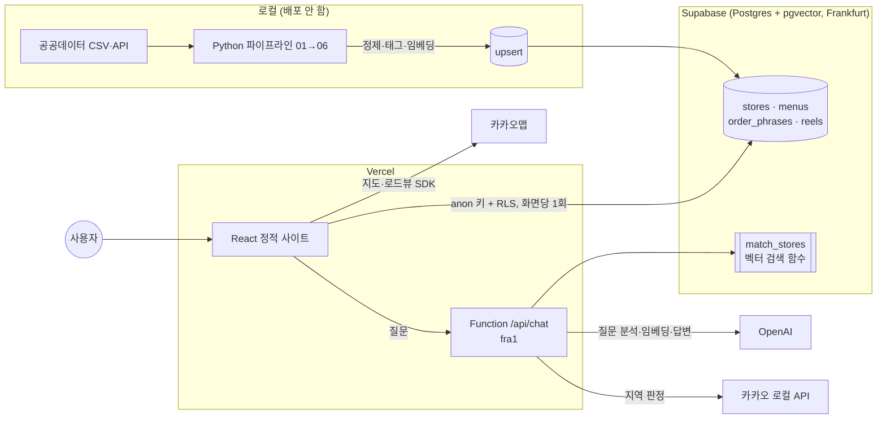
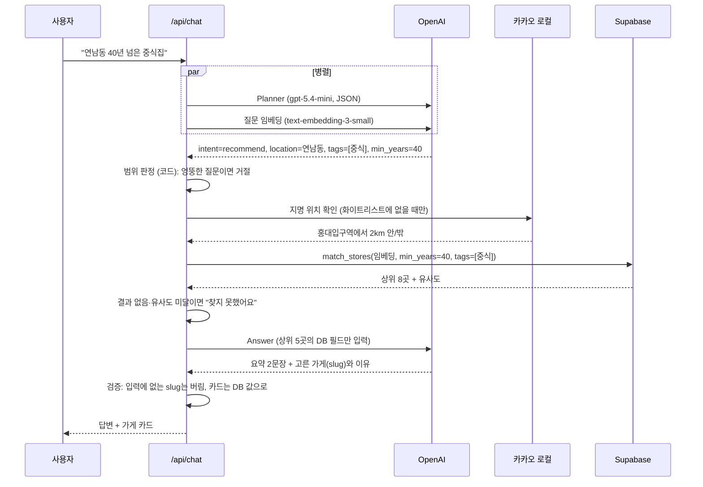

# 나이테 (NAITE)

> 시간이 쌓인 가게, 홍대 노포를 찾는 모바일 웹

홍대입구역 반경 1.8km 안에서 **인허가 기준 30년 이상** 영업 중인 식당을 공공데이터로 모아, 지도·상세·AI 챗봇으로 보여준다. 나무 나이테처럼 **10년 = 1겹**으로 가게의 시간을 표현한다.

**서비스** https://naite-jade.vercel.app (모바일 화면 기준, PC에서는 가운데 480px)

| 홈 | 지도 | 상세 | AI 챗봇 |
| --- | --- | --- | --- |
| 실제 데이터로 만든 배너, 연대·업종별 보기, 역 근처·오래된 가게 TOP 5 | 업종 아이콘 핀, 하단 카드 캐러셀, 검색·필터, 목록 전환 | 업력·인허가일·업종, 출처, 작은 지도, 카카오 로드뷰 | 자연어 질문 → 공공데이터 안에서만 추천 (RAG) |

그 밖에 부산집 영어 메뉴·주문 카드(예시), 릴스(예시), 하트 저장(localStorage), 한/EN 전환이 있다.

---

## 한눈에 보기



- **Vercel**은 화면(React 빌드 결과)과 챗봇 서버 함수(`web/api/chat.ts`)를 함께 배포한다.
- **Supabase**가 데이터 백엔드다. 테이블마다 자동 REST API가 생기고, RLS(행 단위 보안)로 숨김 처리된 가게는 읽을 수 없다. 그래서 목록·상세 조회용 서버를 따로 만들지 않았다.
- **Python 파이프라인**은 데이터를 만들 때 로컬에서 한 번 돌리는 배치 작업이라 배포하지 않는다.

---

## 기술 스택

| 영역 | 사용 기술 | 비고 |
| --- | --- | --- |
| 프론트엔드 | React 19, TypeScript, Vite 8, React Router 8, Tailwind CSS 4 | 모바일 우선, Pretendard 폰트 |
| 지도 | 카카오맵 JavaScript SDK (`react-kakao-maps-sdk`) | 지도·로드뷰는 실시간 표시만 |
| 서버 | Vercel Functions (Node, Web 표준 `Request`/`Response`) | `/api/chat` 하나, 리전 `fra1` |
| DB | Supabase Postgres + **pgvector** (HNSW 인덱스) | RLS, RPC `match_stores` |
| AI | OpenAI **gpt-5.4-mini** (Chat Completions, Structured Outputs) | 질문 분석, 답변 생성, 데이터 정규화 |
| 임베딩 | OpenAI **text-embedding-3-small** (1536차원) | 가게 문서·질문 벡터 |
| 데이터 처리 | Python 3.12, pandas, pyproj, rapidfuzz, requests, openai | 좌표 변환·퍼지 매칭·LLM 캐시 |
| 외부 API | 카카오 로컬 API, 한국관광공사 TourAPI | 카카오는 장소 ID·URL만 저장 |
| 배포 | Vercel Hobby (`main` push 시 자동 배포) | Root Directory `web` |

---

## 1. 공공데이터 전처리

### 사용한 데이터

| 데이터 | 제공 | 쓰임 |
| --- | --- | --- |
| 마포구 일반음식점 인허가 정보 | 서울 열린데이터광장 | **뼈대**. 상호, 인허가일(업력), 업태, 좌표, 주소 |
| 소상공인 상가(상권)정보 | 소상공인시장진흥공단 | 지금도 같은 업종으로 있는지 교차 검사 |
| 마포구 모범음식점 지정 현황 | 서울 열린데이터광장 | 모범음식점 표시, 대표메뉴(주된음식) |
| 백년가게 지정 리스트 | 중소벤처기업부 | 백년가게 표시 |
| TourAPI 음식점 | 한국관광공사 | 대표메뉴 보강 |

### 파이프라인 (`pipeline/01 → 06`)

```
인허가 30,057행
  └ 영업 중 7,801곳
     └ 인허가 30년 이상 + 홍대입구역 1.8km 안 ─→ 후보 149곳
        └ 상가정보 매칭·검사 → LLM 태그 → 카카오 ID 매칭 → 검수 시트
           └ 공개 119곳 / 숨김 30곳 → Supabase
```

| 단계 | 파일 | 하는 일 |
| --- | --- | --- |
| 01 | `01_tourapi.py` | TourAPI 위치 기반 조회로 주변 음식점의 대표메뉴를 모은다. |
| 02 | `02_license_candidates.py` | 영업 중인 가게만 남기고 업력을 계산한다. 좌표를 **EPSG:5174 → WGS84**로 변환하고(pyproj, 상가정보와 맞춰 본 중앙값 오차 약 2m), 반경 1.8km로 거른다. 모범음식점은 허가번호로 정확히 연결하고, 백년가게·TourAPI는 이름 유사도와 거리로 붙인다. |
| 03 | `03_enrich_sangga.py` | 상가정보 3.2만 곳과 **60m 이내 + 이름 유사도(rapidfuzz)**로 매칭한다. 데이터 검사 플래그를 단다(아래 표). |
| 04 | `04_llm_normalize.py` | LLM으로 업종 태그·영문명·프랜차이즈 여부를 판정한다. 대표메뉴와 요약은 LLM 없이 코드 템플릿으로 만든다. |
| 05 | `05_kakao_match.py` | 카카오 키워드 검색으로 80m 안의 같은 이름 장소를 찾아 **장소 ID·URL만** 저장한다(149곳 중 119곳). |
| 06 | `06_embed_upload.py` | 검수 시트 반영 → 출처 목록·검색 문서 작성 → 임베딩 → Supabase upsert, 부산집 예시 데이터를 넣는다. |

### 데이터 검사: "인허가 30년 = 30년 된 가게"가 아니다

영업권을 넘겨받으면(지위승계) 인허가일이 그대로 남는다. 그래서 인허가상으로는 오래됐지만 실제로는 새 가게일 수 있다. 이를 걸러내려고 플래그와 사람 검수를 두었다.

| 플래그 | 뜻 | 건수 |
| --- | --- | --- |
| `type_mismatch` | 인허가 업태와 상가정보 업종이 다름 (예: 한식 → 지금은 주점) | 33 |
| `sangga_unmatched` | 상가정보에서 못 찾음 → 폐업·상호 변경 가능성 | 13 |
| `franchise_*` | 브랜드 키워드, 'OO점' 지점명, 상가정보 지점명 | 31 (중복 포함) |
| `kakao_unmatched` | 카카오에서 같은 장소를 못 찾음 | 30 |

- 프랜차이즈 의심이나 음식점이 아닌 곳은 **삭제하지 않고 숨긴다**(`hidden`).
- 사람 검수 시트 `docs/review.csv`에서 `keep=n`이면 숨기고, `keep=y`면 자동 숨김 규칙을 무시하고 공개한다. 다시 실행해도 표시가 유지된다.

---

## 2. AI 설계: 데이터 정규화와 RAG 챗봇

### 원칙: LLM이 사실을 만들지 못하게

1. **사실은 코드가, 판단만 LLM이 한다.** 업력·대표메뉴·요약 문장은 코드 템플릿으로 만든다(예: "인허가 기준 1985년부터 영업 중인 한식 가게예요. 등록된 대표메뉴: 장어구이."). LLM은 분류(태그, 의도)와 짧은 요약만 맡는다.
2. **출력은 JSON 스키마로 고정한다.** OpenAI Structured Outputs(`response_format: json_schema, strict: true`)를 쓰고, 태그는 24개 목록(enum) 밖으로 나갈 수 없다.
3. **LLM 결과는 다시 검증한다.** 태그는 가게명·대표메뉴·상가 업종에 근거 단어가 있을 때만 남긴다. 챗봇이 고른 가게는 검색 결과 안에 있는 것만 인정한다.
4. **입력 속 지시는 따르지 않는다.** 프롬프트 인젝션은 분석 대상으로만 본다(평가 케이스에 포함).

### 데이터 정규화 (파이프라인 04)

| 항목 | 방법 |
| --- | --- |
| 모델 | `gpt-5.4-mini`, Structured Outputs |
| 출력 | `cuisine_tags`(24개 중 0~3), `franchise_suspect`, `franchise_reason`, `name_en`(로마자 표기) |
| 검증 | `TAG_EVIDENCE` 키워드 사전으로 근거 없는 태그 제거 |
| 비용 | 입력·모델·프롬프트 버전 해시로 `llm_cache.jsonl`에 캐시, 같은 입력은 다시 호출하지 않음. 8개 병렬 처리 |

### RAG: 무엇을 검색하나

가게마다 사실만 담은 **검색 문서(`search_text`)**를 만들어 임베딩한다.

```
가게: 부산집 (Busan Jip)
업력: 인허가 기준 1985년부터, 약 41년
업종: 한식 / 장어
대표메뉴: 장어구이 (출처: 마포구 모범음식점)
위치: 서울특별시 마포구 월드컵북로 18, 동교동, 홍대입구역에서 약 376m
특징: 마포구 모범음식점
요약: 인허가 기준 1985년부터 영업 중인 한식 가게예요. … / …
```

- 임베딩: `text-embedding-3-small`(1536차원) → `stores.embedding`(pgvector, HNSW, 코사인 거리)
- 검색 함수 `match_stores`: **벡터 유사도 + 정형 조건(업력 이상, 태그 겹침, 거리)**을 SQL 한 번에 처리하는 하이브리드 검색이다. 카드에 필요한 필드를 함께 돌려줘서 다시 조회하지 않는다. anon 키로 호출해도 RLS가 적용되어 숨김 가게는 나오지 않는다.

### 챗봇 요청 흐름 (`web/api/chat.ts`)



| 단계 | 하는 일 | 왜 |
| --- | --- | --- |
| ① Planner | 의도, 지명, 태그(enum), 업력 조건, 목록에 없는 음식, 언어를 JSON으로 뽑는다 | 자연어를 검색 조건으로 바꾼다 |
| ② 범위 판정 | 엉뚱한 질문 → 거절, 지역 밖 → 안내, 확인 안 되는 지명 → 되묻기 | **LLM이 아닌 코드**로 판정해 결과가 일정하다 |
| ③ 검색 | 벡터 + 조건 검색. 태그로 0건이면 태그 없이 다시 찾고 "비슷한 곳"이라고 알린다 | 너무 엄격해서 빈손이 되는 것을 막는다 |
| ④ 결과 없음 판정 | 목록에 없는 음식(비건, 타코 등)이 결과에 없거나, 최고 유사도가 `SIM_THRESHOLD`(0.25) 미만 | 억지 추천을 하지 않는다 |
| ⑤ 답변 | 검색된 가게의 사실 필드만 주고 2문장 요약 + 가게별 이유 한 줄 | 근거 밖 내용(맛, 인기)을 쓰지 못하게 |
| ⑥ 검증 | 고른 slug가 입력에 있는지 확인, 카드는 DB 값으로 그림 | 가게를 지어내지 못하게 |

비용·남용 보호: 질문 500자 제한, IP당 분당 12회, OpenAI 호출 타임아웃 20초. OpenAI 키는 서버에만 있다.

### 평가 (`pipeline/eval/`)

질문 32개(홍대 안 16, 지역 밖 7, 엉뚱한 질문·인젝션 6, 결과 없음 3)로 범위 판정을 잰다.

| 환경 | 범위 정확도 | 태그 적중 | 평균 응답 |
| --- | --- | --- | --- |
| 로컬 | 32/32 (100%) | 10/10 | 2.1초 |
| 배포 (Vercel fra1) | 32/32 (100%) | 10/10 | 2.4초 |

```bash
.venv/bin/python pipeline/eval/run_eval.py https://naite-jade.vercel.app   # 한 번에 하나만 실행 (분당 제한)
```

---

## 3. OpenAI 사용 정리

| 쓰는 곳 | 모델 | API | 입력 → 출력 |
| --- | --- | --- | --- |
| 파이프라인 04 정규화 | `gpt-5.4-mini` | Chat Completions + Structured Outputs | 가게명·업태·메뉴·상가 업종 → 태그·영문명·프랜차이즈 판정 |
| 파이프라인 06 임베딩 | `text-embedding-3-small` | Embeddings (배치) | 검색 문서 → 1536차원 벡터 |
| 챗봇 Planner | `gpt-5.4-mini` | Chat Completions + Structured Outputs | 질문 → 검색 조건 JSON |
| 챗봇 질문 임베딩 | `text-embedding-3-small` | Embeddings | 질문 → 벡터 (Planner와 병렬) |
| 챗봇 Answer | `gpt-5.4-mini` | Chat Completions + Structured Outputs | 가게 사실 5곳 → 요약·추천 이유 |

모델은 환경변수(`OPENAI_CHAT_MODEL`, `OPENAI_EMBED_MODEL`)로 바꿀 수 있다. 질문 하나당 OpenAI 호출은 최대 3번(Planner, 임베딩, Answer)이고, 엉뚱한 질문이나 지역 밖 질문은 2번에서 끝난다.

---

## 데이터 원칙

- 모든 가게 정보에 출처(`sources`)를 붙이고 상세 화면에 보여준다. 입력에 없는 사실(맛, 인기, 분위기, 개업 사연)은 만들지 않는다.
- 업력은 항상 **"인허가 기준"**이라고 쓴다.
- 예시 데이터(부산집 메뉴·사진·릴스)에는 `예시`, 검수 전 데이터에는 `검수 전` 뱃지를 붙인다.
- 카카오 API 응답은 장소 ID·URL만 저장하고, 좌표·주소는 공공데이터 것을 쓴다. 카카오·블로그·리뷰 사진은 쓰지 않는다. 사진 대신 **나이테 동심원 + 업종 아이콘** 그래픽을 쓴다.

---

## 폴더 구조

```
naite/
├─ web/                    # Vercel Root Directory
│  ├─ src/pages/           # Home, Map, Store, Menu, OrderCard, Reels, Ask
│  ├─ src/components/      # TabsLayout(4탭·스와이프), StoreCard, CategoryIcon, Logo, Roadview …
│  ├─ src/lib/             # supabase(요청 캐시), category, i18n, saved, mapFilter …
│  ├─ api/chat.ts          # 챗봇 서버 함수 (RAG)
│  └─ vercel.json          # 리전 fra1, SPA 라우팅
├─ pipeline/               # 01~06 데이터 파이프라인, eval/ 챗봇 평가
├─ supabase/migrations/    # 테이블·RLS·match_stores SQL
├─ data/processed/         # 최종 stores.jsonl / stores.csv
└─ docs/                   # review.csv(검수 시트), PROGRESS.md, DATA_SOURCES.md
```

---

## 실행

```bash
# 1) 환경변수: .env.example 을 복사해 루트 .env 작성
# 2) 데이터 파이프라인 (Python 3.12)
python3 -m venv .venv && .venv/bin/pip install -r pipeline/requirements.txt
.venv/bin/python pipeline/01_tourapi.py      # … 06_embed_upload.py 까지 순서대로
# 3) 웹 (http://localhost:5180, /api/chat 도 같이 실행됨)
cd web && npm install && npm run dev
```

DB 스키마는 `supabase/migrations/*.sql`을 Supabase SQL Editor에서 실행한다. 자세한 규칙은 `CLAUDE.md`, 진행 기록은 `docs/PROGRESS.md`에 있다.

## 배포

- 프로덕션: https://naite-jade.vercel.app (Vercel Hobby, `main` push 시 자동 배포)
- Vercel 설정: Root Directory `web`, Framework Vite, 함수 리전 `fra1`(`web/vercel.json`)
- Vercel 환경변수: `VITE_SUPABASE_URL`, `VITE_SUPABASE_ANON_KEY`, `VITE_KAKAO_JS_KEY`, `SUPABASE_URL`, `OPENAI_API_KEY`, `OPENAI_CHAT_MODEL`, `OPENAI_EMBED_MODEL`, `KAKAO_REST_KEY`, `SIM_THRESHOLD`. `SUPABASE_SERVICE_ROLE_KEY`·`TOUR_KEY`는 넣지 않는다(파이프라인 전용).
- 카카오 developers → 앱 → 플랫폼 키 → JavaScript 키 → JavaScript SDK 도메인에 `http://localhost:5180`과 배포 주소를 등록한다.

## 한계와 다음 단계

- 인허가 데이터만으로는 영업권 승계 여부를 알 수 없다 → 검수 시트로 사람이 확인한다.
- 대표메뉴가 확인된 가게는 149곳 중 10곳뿐이다(모범음식점 9, TourAPI 1). 나머지는 "메뉴 미확인"으로 표시한다.
- 저장은 기기별(localStorage)이다 → Supabase 익명 로그인으로 기기 간 동기화를 할 수 있다.
- 서비스 지역은 홍대입구역 주변뿐이다. 지역을 늘릴 때는 파이프라인의 중심 좌표·구 단위 데이터를 바꾸면 된다.

## 데이터 출처

서울특별시 마포구 일반음식점 인허가 정보 · 소상공인시장진흥공단 상가(상권)정보 · 서울특별시 마포구 모범음식점 지정 현황 · 중소벤처기업부 백년가게 · 한국관광공사 TourAPI (공공누리) · 지도·로드뷰: 카카오
